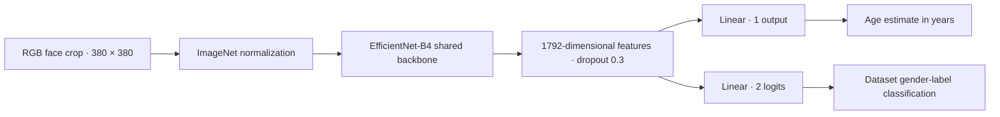

# EfficientNet-B4 Age and Gender Estimation Research

**Multi-task facial age regression and gender-label classification with EfficientNet-B4.**

[中文说明](README.zh-CN.md) · [Model card](docs/model-card.md) · [Experiments](docs/experiments.md) · [Reproducibility](docs/reproducibility.md)

This research repository studies a shared EfficientNet-B4 backbone with separate age and gender prediction heads, multi-source face data, geometric preprocessing, and composite data augmentation. It includes historical experiment evidence alongside a new manifest-based training and evaluation pipeline.

The work focuses on **model training, backbone comparisons and ablation experiments**. A web application is outside this repository's scope.

## Research questions

- How does EfficientNet-B4 compare with B0, ResNet-50 and VGG-16 under the archived experimental settings?
- How do augmentation, face alignment and the gender-loss coefficient affect the two tasks?
- How can data splits, checkpoints and measured results be kept traceable in subsequent experiments?

## Model



The objective is `L = L1(age) + 6 × CrossEntropy(gender, label_smoothing=0.1)`. Historical B4 settings use 35 epochs, batch size 64, AdamW with weight decay 0.05, OneCycleLR with maximum learning rate 4e-4, mixed precision, and gradient clipping at 1.0.

## Historical experiment snapshot

| Run | Epochs | Final validation age MAE ↓ | Final validation gender accuracy ↑ |
| --- | ---: | ---: | ---: |
| EfficientNet-B4 | 35 | 3.4074 years | 98.2064% |
| EfficientNet-B4 comparison baseline | 15 | 3.5445 years | 98.1699% |

These values come from archived CSV validation logs, **not a fresh evaluation or independently verified test benchmark**. The original sample-level split manifest was not retained. The selected C3 checkpoint is different from another same-named historical full-data checkpoint. See [provenance](docs/provenance.md) before comparing results.

## Experiment progression

1. **Backbone selection (15 epochs):** EfficientNet-B4 vs ResNet-50 vs VGG-16.
2. **EfficientNet scaling (15 epochs):** B4 vs B0.
3. **Training settings (15 epochs each):** augmentation, loss weighting and alignment, each in its own figure.
4. **Final training (35 epochs):** the selected B4 configuration, shown separately.

[View grouped comparison figures and tables](docs/experiments.md)


## Quick start

Use Python 3.10 or newer and install a PyTorch build appropriate to your CPU/GPU from the [official selector](https://pytorch.org/get-started/locally/). The current repository checks are recorded in [validation](docs/validation.md).

```powershell
python -m venv .venv
# Windows: invoke this interpreter directly; activation is optional.
.\.venv\Scripts\python.exe -m pip install -e ".[dev]"
.\.venv\Scripts\python.exe -m age_gender.predict --image path/to/face_crop.jpg
```

On Linux/macOS use `.venv/bin/python` instead. The prediction input must already be a cropped face. Output contains an unbounded age estimate, a dataset label (0=male, 1=female), and uncalibrated class probabilities. No demographic performance claim follows from a single prediction.

### New training experiments

Place authorized, aligned data under three folders; filenames start with `{age}_{gender}_`:

```text
data/aligned/
├── UTKFace/25_0_example.jpg
├── AFAD/28_1_example.jpg
└── imdb/43_0_example.jpg
```

```powershell
python -m age_gender.split --data-root data/aligned --output data/manifest.csv
python -m age_gender.train --config configs/b4.json --data-root data/aligned --manifest data/manifest.csv --output runs/b4 --verify-hashes
python -m age_gender.evaluate --checkpoint runs/b4/best.pth --data-root data/aligned --manifest runs/b4/manifest.csv --split test --output runs/b4/test.json
```

New experiments use a **persisted 80/10/10 split grouped by exact image hash**. This differs from the historical 80/20 protocol. Exact duplicates stay together; identity-disjointness and near-duplicate exclusion are not guaranteed. Use identity metadata and a separately audited protocol for identity-independent evaluation. Never use the new manifest to claim the old checkpoint was trained on its training partition.

Optional preprocessing accepts a labelled input CSV; see [data preparation](docs/data.md). Model-only latency can be measured with `python -m age_gender.benchmark --device cpu` (CUDA timing synchronizes explicitly).

## Repository map

```text
age_gender/              Unified model, split, training, evaluation and inference
configs/                 Explicit research configurations
experiments/legacy/      Archived scripts, separate from the new pipeline
experiments/logs/        Eight historical CSV training records
experiments/figures/     Figures regenerated from those records
weights/                 C3 epoch-35 checkpoint and SHA256 provenance
docs/                    Protocol, results, model card, limitations and validation
tests/                   Split isolation, metrics and checkpoint checks
```

## Limitations and next experiments

The model uses established architectures and does not introduce a new backbone. Historical improvements are single-run observations without confidence intervals. Planned work includes identity-aware deduplication, independent external evaluation, repeated seeds, age/source subgroup analysis, and calibrated uncertainty. See [limitations](docs/limitations.md).

Datasets and private face images are not distributed. Dataset gender labels are limited binary annotations and do not determine a person's gender identity. The repository is for research on authorized imagery; no surveillance deployment or production readiness is claimed.

## Attribution and licensing status

Author: **EricLiangyh (Liang Yiheng)**. No project-wide open-source license has been selected. Code and model redistribution rights have not been granted by a repository license. Third-party software, datasets and pretrained models retain their own terms; see [third-party sources](THIRD_PARTY_NOTICES.md). No full dataset, database, personal photograph or unrelated application is included.
