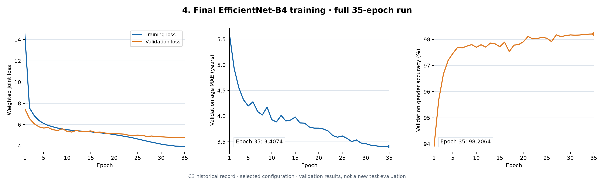

# EfficientNet-B4 Age and Gender Estimation Research

**A personal research project on joint facial age regression and gender-label classification.** It investigates how backbone choice, face alignment, augmentation and task-loss weighting affect a shared EfficientNet-B4 model.

[中文说明](README.zh-CN.md) · [Research results](docs/experiments.md) · [Model card](docs/model-card.md)

## Research motivation

Image-based audience analysis needs both age estimates and attribute classification, while face pose, image quality and data-source differences complicate prediction. This project studies a shared visual representation for the two tasks and examines the effects of specific preprocessing and training choices. Its focus is experimental analysis of established architectures.

## My work in this project

- Built a multi-source preprocessing workflow for UTKFace, AFAD and a locally prepared IMDB subset, including label conversion, landmark-based rotation and expanded face cropping.
- Adapted an ImageNet-pretrained EfficientNet-B4 into a shared backbone with separate age regression and two-logit classification heads.
- Conducted backbone comparisons and augmentation, loss-weight and alignment ablations; retained eight historical training logs and their experiment scripts.
- Analyzed convergence and task trade-offs, and provided a selected checkpoint with a minimal cropped-face inference entry point.

The research contribution is the task adaptation, training workflow and experimental analysis. EfficientNet and the pretrained components are credited to their original authors; no new backbone or state-of-the-art result is claimed.

## Explore the implementation

| Step | Entry | What to inspect |
| --- | --- | --- |
| **1. Data preprocessing** | [preprocessing/](preprocessing/README.md) | Original complete script, dataset layout, labels, alignment and crop settings |
| **2. Model training** | [training/](training/README.md) | Original complete training implementation, architecture, augmentation and loss |
| **3. Trained model** | [weights/](weights/README.md) | C3 checkpoint, prediction command and input requirements |

### Which training version produced the selected artifact?

| Artifact | Training protocol | Relationship to the distributed weights |
| --- | --- | --- |
| [Original train_pro.py](training/train_pro.py) | All merged data; no held-out validation loop | Preserved original implementation; a different historical training version |
| [Archived C3 b4_35.py](experiments/legacy/b4_35.py) | 80/20 image-level training/validation split, 35 epochs | Associated by source folder with the [selected checkpoint](weights/efficientnet_b4_c3_epoch35.pth) and [C3 log](experiments/logs/b4_35.csv) |

Original scripts are unchanged. File integrity is recorded, but the original sample-membership manifest is unavailable; folder association and matching architecture do not independently prove training provenance. [Details](docs/provenance.md).

## Method

```text
Aligned RGB face, 380×380 → ImageNet normalization → EfficientNet-B4
                                                   ↓ shared 1792-D features
                                                   ├── age regression: 1 value
                                                   └── gender labels: 2 logits
```

The joint objective is `L1(age) + 6 × CrossEntropy(gender)` with label smoothing 0.1. Historical training uses AdamW, OneCycleLR, mixed precision and composite augmentation. The implementation uses PyTorch/Torchvision, InsightFace, OpenCV and Pillow; their roles and configuration are explained in the [method guide](docs/methodology.md).

## Key experimental observations

Comparisons below use the final validation rows of the **15-epoch historical runs**. Lower MAE is better; accuracy is in percent.

| Research question | Observation in the archived records |
| --- | --- |
| Backbone family | B4: **3.5445** years MAE; ResNet-50: 3.8423; VGG-16: 4.1115 |
| EfficientNet scale | B4: **3.5445** years MAE versus B0: 3.6903 |
| Data augmentation | MAE: 3.6520 without augmentation → **3.5445** with full augmentation |
| Task-loss weighting | Gender accuracy: 97.8283% at weight 1 → **98.1699%** at weight 6; age MAE changes only slightly, 3.5490 → 3.5445 |
| Face alignment | Gender accuracy: 97.4825% without alignment → **98.1699%** with alignment; MAE: 3.6101 → 3.5445 |

The separate **35-epoch C3 record** ends at **3.4074 years validation MAE** and **98.2064% validation accuracy**. Its longer budget is shown separately from the 15-epoch comparisons.

These are single-run historical validation observations, not newly verified independent-test benchmarks. They suggest directions for further experiments, but do not establish statistically significant or fully controlled causal effects.

[Grouped figures and source CSVs](docs/experiments.md) · [Experiment script index](experiments/README.md)



## Quick start: run the selected checkpoint

Python, Git and a compatible PyTorch/Torchvision environment are required. While the repository is private, cloning requires an account with access.

```powershell
git clone https://github.com/EricLiangyh/efficientnet-b4-age-gender-research.git
cd efficientnet-b4-age-gender-research
python -m venv .venv
.\.venv\Scripts\python.exe -m pip install -r requirements.txt
.\.venv\Scripts\python.exe weights/predict.py --image "path/to/face_crop.jpg" --device cpu
```

On Linux/macOS replace `.\.venv\Scripts\python.exe` with `.venv/bin/python`. For CUDA, choose a matching PyTorch build before running inference. Model initialization uses the included checkpoint and does not download ImageNet weights.

### Authorized photograph example


This photograph was supplied by the project owner with permission to display it in this repository. The original image is preserved unchanged. It includes the upper body and background: crop a single complete face with a small forehead/chin margin before inference, and save your working crop locally as `face_crop.jpg`. Resizing to 380×380 is automatic.

No measured predictions or ground-truth labels are attached to this photograph. The photograph is an input reference, not an accuracy benchmark. Display permission does not grant a general reuse license to visitors.

Run the prediction command on your prepared face crop:


```powershell
.\.venv\Scripts\python.exe weights/predict.py --image "path/to/face_crop.jpg" --device cpu
```

Use one complete face with a small margin around the forehead and chin, not an uncropped group photo. Resizing is automatic; face detection is not included. [Input and output guide](weights/README.md).

## Scope and next research steps

The repository contains original research code, historical evidence and inference, not a turnkey training/evaluation framework. Training/preprocessing dependencies and original Linux/CUDA paths require separate setup. Full-dataset reevaluation, original split reconstruction and identity-disjoint testing have not been completed.

Next steps are identity-aware deduplication and frozen split manifests, an untouched external test set, repeated seeds and subgroup/error analysis. Binary dataset labels do not determine personal gender identity. [Model limitations](docs/model-card.md).

```text
preprocessing/   Original preprocessing and configuration guide
training/        Original training and parameter guide
weights/         Selected checkpoint, prediction code and example
experiments/     Historical scripts, eight logs and six figures
docs/            Method, results, model card and provenance
```

Author: **EricLiangyh (Yiheng Liang)**. No project-wide license is selected. Code, data and pretrained-model usage terms must be considered separately; see [third-party notices](THIRD_PARTY_NOTICES.md). No training dataset or private photograph is distributed.
