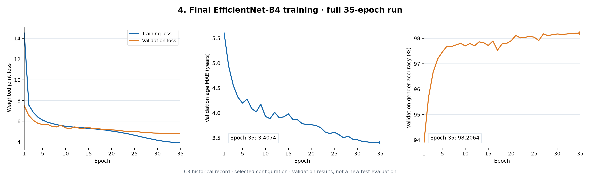

# 基于 EfficientNet-B4 的人脸年龄与性别预测研究

[English](README.md)

## 先看这三个入口

| 顺序 | 文件 | 内容 |
| --- | --- | --- |
| **1. 数据预处理** | [preprocess_pro.py](preprocess_pro.py) | 原始数据扫描、标签转换、关键点旋转对齐与裁剪 |
| **2. 模型训练** | [train_pro.py](train_pro.py) | 原始 B4 双任务结构、数据增强、联合损失和训练循环 |
| **3. 训练好的模型** | [weights/](weights/README.md) | C3 第 35 轮权重、来源和使用方式 |

两个原始脚本完整保留，未经改动。现有权重来自另一组 [C3 划分训练实验](experiments/legacy/b4_35.py)，与根目录的全数据训练脚本分别记录；详见 [来源说明](docs/provenance.md)。

## 研究方法

以 EfficientNet-B4 提取共享特征，连接年龄回归头与性别标签分类头；使用年龄 L1 损失、加权分类交叉熵，以及 AdamW、OneCycleLR 和复合数据增强。

[查看数据处理、参数解释与评估说明](docs/methodology.md)

## 实验阅读顺序

1. **模型选择，15 轮**：B4、ResNet-50、VGG-16。
2. **模型规模，15 轮**：B4 与 B0。
3. **训练策略，各 15 轮**：数据增强、任务权重、人脸对齐分别比较。
4. **最终训练，35 轮**：单独展示选定 B4 配置的损失与验证指标。

[实验脚本与日志索引](experiments/README.md) · [分组结果图表](docs/experiments.md)

最终历史验证日志记录 MAE **3.4074 岁**、分类准确率 **98.2064%**；它们不是本次重新完成的独立测试成绩。历史逐样本划分清单未保留。



## 使用现有模型

准备兼容的 PyTorch/Torchvision 环境后，在仓库根目录执行：

```powershell
python -m pip install -r requirements.txt
python predict.py --image path/to/face_crop.jpg
```

输入是已裁剪的人脸图片。`predict.py` 仅执行预测，不自动检测人脸，也不计算准确率。标签 0/1 对应数据集的 male/female 标注，不能等同于对个人性别身份的判断。

## 精简目录

```text
preprocess_pro.py        原始数据预处理
train_pro.py             原始模型训练
predict.py               单文件推理入口
weights/                 已训练模型和校验信息
experiments/             历史实验脚本、八组日志、六张图
scripts/plot_results.py  从 CSV 重新生成实验图
docs/                    方法、模型卡、结果与来源说明
```

未包含数据集、私人图像、前后端或额外训练框架。当前未选择项目许可证；第三方内容遵循 [各自条款](THIRD_PARTY_NOTICES.md)，使用限制见 [模型卡](docs/model-card.md)。
