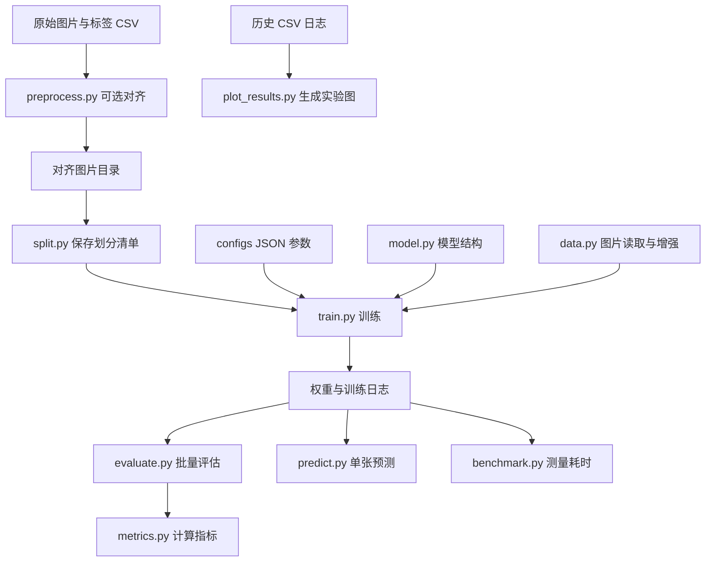

# age_gender：整理后的模型研究代码

[返回项目首页](../README.md) · [查看原始工作流程](../docs/original-workflow.md) · [调参指南](../docs/tuning.md)

这里是后续整理出的 Python 代码包，方便统一进行数据划分、训练、评估和推理。**如果你第一次阅读项目，先看根目录的 [preprocess_pro.py](../preprocess_pro.py)、[train_pro.py](../train_pro.py) 和 [模型权重](../weights/README.md)。** 原始文件完整保留，没有被本目录替代。

本目录的新代码与历史脚本在数据划分、预处理和输出记录上有差异。历史验证成绩对应历史实验，不能据此认定新代码已经复现相同数值。

## 代码怎样连接



## 按文件理解

| 文件 | 它解决什么问题 | 输入 | 输出 / 被谁调用 |
| --- | --- | --- | --- |
| [model.py](model.py) | 模型长什么样、怎样加载权重 | 骨干名称或权重文件 | 年龄回归值、两个分类 logits；供训练/评估/预测调用 |
| [preprocess.py](preprocess.py) | 怎样把原图变成统一的人脸图片 | 图片根目录和 `path,age,gender,source` CSV | 380×380 人脸图片及处理报告 |
| [data.py](data.py) | 怎样读取标签、检查清单并增强图片 | 图片目录、数据清单、变换配置 | 图片张量、年龄、分类标签 |
| [split.py](split.py) | 哪些图片训练、哪些验证、哪些测试 | 对齐图片目录 | 含路径、标签、SHA256、split 的 CSV |
| [train.py](train.py) | 按选定参数训练模型 | 配置 JSON、图片、划分清单 | `best.pth`、`last.pth`、`training.csv`、`run.json` 和清单副本 |
| [evaluate.py](evaluate.py) | 模型在一批有真实标签的图片上表现怎样 | 已训练权重、图片和划分清单 | 指标 JSON 与逐图片预测 CSV；[详细说明](../docs/evaluation.md) |
| [metrics.py](metrics.py) | 怎样计算误差与分类指标 | 真实值与预测值 | MAE、RMSE、准确率、混淆矩阵、各类 precision/recall/F1 |
| [predict.py](predict.py) | 单张人脸图会得到什么结果 | 一张已裁剪的人脸图和权重 | 年龄估计、分类标签和类别概率 |
| [benchmark.py](benchmark.py) | 属性模型一次计算花多久 | 权重、设备、批量大小 | 含预热和计时条件的耗时 JSON |
| [plot_results.py](plot_results.py) | 怎样从历史日志重画研究图表 | `experiments/logs/` 下的八组 CSV | 分组图、汇总 JSON 和实验说明页 |
| [__init__.py](__init__.py) | 标识 Python 包 | 无需单独运行 | 包版本信息 |

`model.py`、`data.py`、`metrics.py` 是共用模块，通常无需直接运行。其余入口从**仓库根目录**用 `python -m age_gender.模块名` 调用，例如 `python -m age_gender.evaluate --help`。不要进入此目录后执行 `python evaluate.py`，它使用了包内相对导入。

## 我想做什么，应该看哪里

| 目的 | 阅读顺序 |
| --- | --- |
| 了解原始研究实现 | [原始预处理](../preprocess_pro.py) → [原始训练](../train_pro.py) → [权重说明](../weights/README.md) |
| 对现有模型试一张人脸图 | [predict.py](predict.py) → [权重使用步骤](../weights/README.md) |
| 重新训练并调整参数 | [configs 说明](../configs/README.md) → [调参指南](../docs/tuning.md) → [train.py](train.py) |
| 衡量模型效果 | [评估指南](../docs/evaluation.md) → [evaluate.py](evaluate.py) |
| 查看模型选择和调参依据 | [实验导航](../experiments/README.md) → [分组实验图表](../docs/experiments.md) |

## 完整的新实验示例

准备好图片和依赖后，在仓库根目录依次执行：

```powershell
python -m age_gender.split --data-root data/aligned --output data/manifest.csv
python -m age_gender.train --config configs/b4.json --data-root data/aligned --manifest data/manifest.csv --output runs/b4 --verify-hashes
python -m age_gender.evaluate --checkpoint runs/b4/best.pth --data-root data/aligned --manifest runs/b4/manifest.csv --split test --output runs/b4/test.json
```

以上是新代码流程：默认 80/10/10 划分，相同文件哈希归入同一集合；不是对历史 C3 80/20 划分的还原。单张预测不需要真实标签，批量评估需要真实年龄和分类标签。修改模型参数请看 [调参指南](../docs/tuning.md)，不是修改 `evaluate.py`。

English: This directory contains the revised research package, not the verbatim original scripts. Start with the root preprocessing/training files and weight guide, then use this index to explore training, tuning, evaluation and inference.
