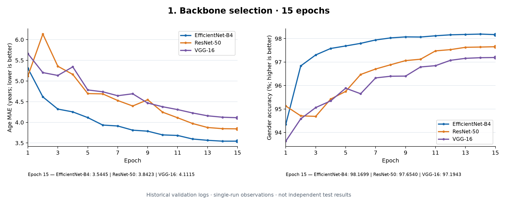
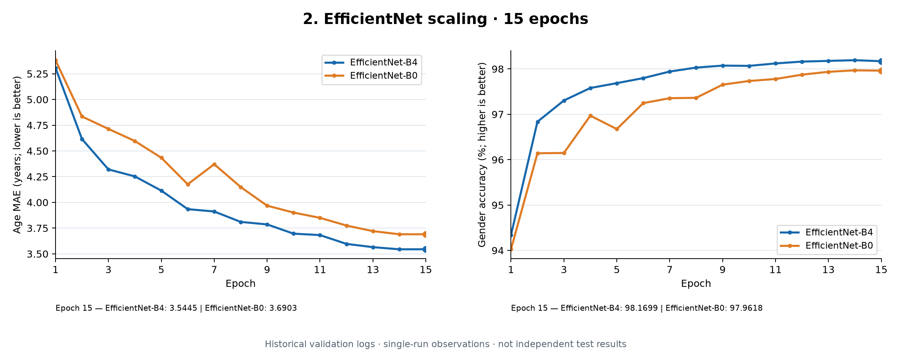
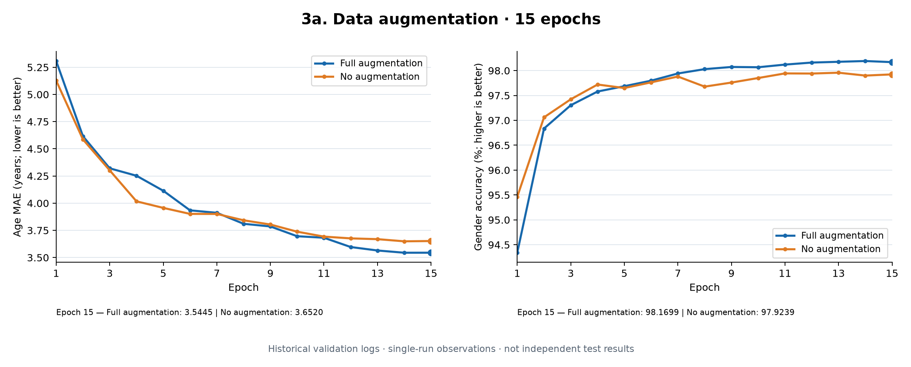
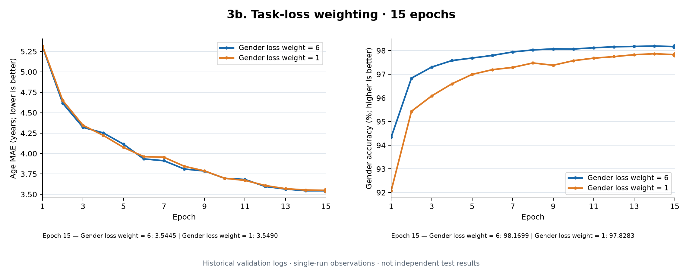
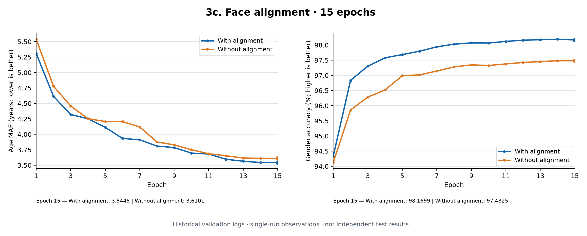

# Historical experiments by research stage

Figures are organized by research question. This is a presentation order, not a claim about the chronological order of archived runs. All values are historical validation observations, not independently remeasured test results.

## 1. Backbone selection

Compare model families under a 15-epoch budget.

| Configuration | Epochs | Age MAE (years) | Gender accuracy (%) | Source |
| --- | ---: | ---: | ---: | --- |
| EfficientNet-B4 | 15 | 3.5445 | 98.1699 | [CSV](../experiments/logs/b4_15.csv) |
| ResNet-50 | 15 | 3.8423 | 97.6540 | [CSV](../experiments/logs/resnet50_15.csv) |
| VGG-16 | 15 | 4.1115 | 97.1943 | [CSV](../experiments/logs/vgg16_15.csv) |

## 2. EfficientNet scaling

Compare B4 and B0 under a 15-epoch budget.

| Configuration | Epochs | Age MAE (years) | Gender accuracy (%) | Source |
| --- | ---: | ---: | ---: | --- |
| EfficientNet-B4 | 15 | 3.5445 | 98.1699 | [CSV](../experiments/logs/b4_15.csv) |
| EfficientNet-B0 | 15 | 3.6903 | 97.9618 | [CSV](../experiments/logs/b0_15.csv) |

## 3a. Data augmentation

Hold the B4 baseline fixed and compare augmentation settings.

| Configuration | Epochs | Age MAE (years) | Gender accuracy (%) | Source |
| --- | ---: | ---: | ---: | --- |
| Full augmentation | 15 | 3.5445 | 98.1699 | [CSV](../experiments/logs/b4_15.csv) |
| No augmentation | 15 | 3.6520 | 97.9239 | [CSV](../experiments/logs/b4_no_augmentation_15.csv) |

## 3b. Task-loss weighting

Compare gender-loss coefficients for the 15-epoch B4 runs.

| Configuration | Epochs | Age MAE (years) | Gender accuracy (%) | Source |
| --- | ---: | ---: | ---: | --- |
| Gender loss weight = 6 | 15 | 3.5445 | 98.1699 | [CSV](../experiments/logs/b4_15.csv) |
| Gender loss weight = 1 | 15 | 3.5490 | 97.8283 | [CSV](../experiments/logs/b4_gender_weight_1_15.csv) |

## 3c. Face alignment

Compare the archived aligned and unaligned B4 experiments.

| Configuration | Epochs | Age MAE (years) | Gender accuracy (%) | Source |
| --- | ---: | ---: | ---: | --- |
| With alignment | 15 | 3.5445 | 98.1699 | [CSV](../experiments/logs/b4_15.csv) |
| Without alignment | 15 | 3.6101 | 97.4825 | [CSV](../experiments/logs/b4_no_alignment_15.csv) |

## 4. Final training: selected EfficientNet-B4 configuration

The final figure uses the complete 35-epoch C3 record. It separates training/validation joint loss, validation age MAE and validation gender accuracy. It is not mixed with the 15-epoch comparisons.

[Final-run CSV](../experiments/logs/b4_35.csv) · [Provenance and comparison limitations](provenance.md)

Archived runs do not establish fully controlled comparisons or statistical significance. Original split membership is unavailable; preprocessing and architecture details should be audited before drawing causal conclusions.
