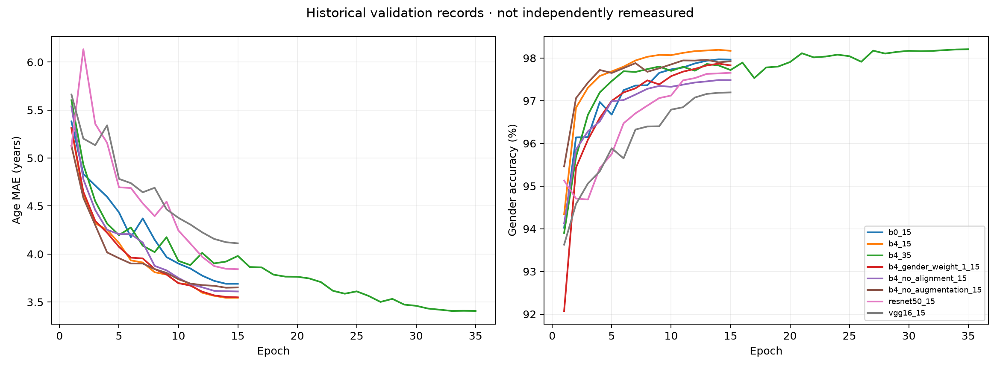
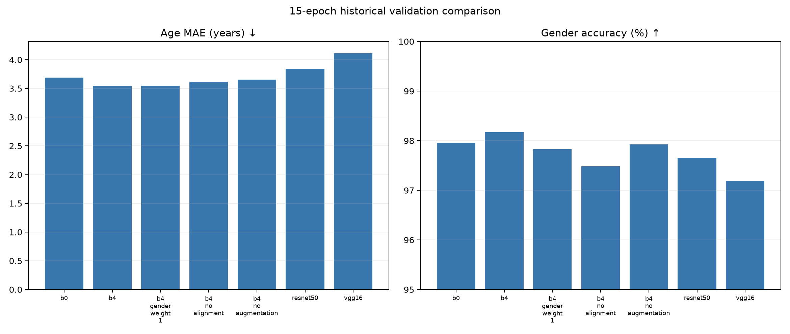

# Historical validation results

Generated from final rows of committed CSV logs. Not independently remeasured test results.

| Run | Epochs | Age MAE (years) | Gender accuracy (%) | Evidence |
| --- | ---: | ---: | ---: | --- |
| b0_15 | 15 | 3.6903 | 97.9618 | [b0_15](../experiments/logs/b0_15.csv) |
| b4_15 | 15 | 3.5445 | 98.1699 | [b4_15](../experiments/logs/b4_15.csv) |
| b4_35 | 35 | 3.4074 | 98.2064 | [b4_35](../experiments/logs/b4_35.csv) |
| b4_gender_weight_1_15 | 15 | 3.5490 | 97.8283 | [b4_gender_weight_1_15](../experiments/logs/b4_gender_weight_1_15.csv) |
| b4_no_alignment_15 | 15 | 3.6101 | 97.4825 | [b4_no_alignment_15](../experiments/logs/b4_no_alignment_15.csv) |
| b4_no_augmentation_15 | 15 | 3.6520 | 97.9239 | [b4_no_augmentation_15](../experiments/logs/b4_no_augmentation_15.csv) |
| resnet50_15 | 15 | 3.8423 | 97.6540 | [resnet50_15](../experiments/logs/resnet50_15.csv) |
| vgg16_15 | 15 | 4.1115 | 97.1943 | [vgg16_15](../experiments/logs/vgg16_15.csv) |

The 15-epoch comparisons and 35-epoch main experiment have different training budgets. See [provenance](provenance.md) for split and checkpoint limitations.

