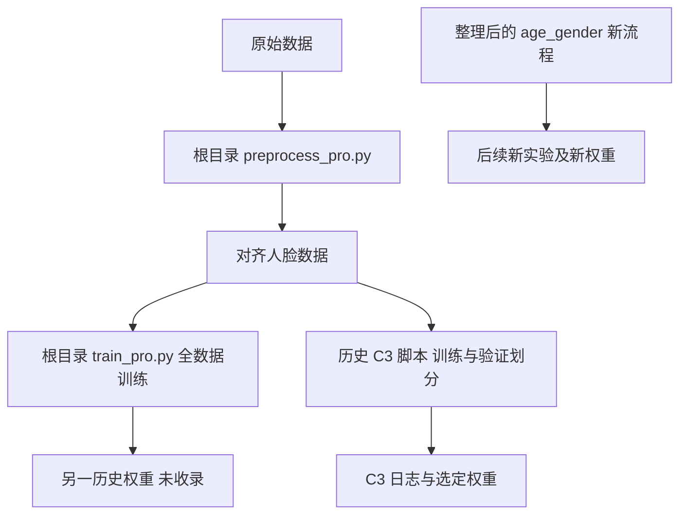

# 第一次进入项目：先看实现，再看实验依据

[返回首页](../README.md) · [全部文档](README.md)

## 第一层：先弄清模型怎样得到

| 顺序 | 点击查看 | 重点看什么 |
| --- | --- | --- |
| 1 | [preprocess_pro.py](../preprocess_pro.py) | 数据来源、标签转换、人脸旋转对齐、裁剪大小、输出目录 |
| 2 | [train_pro.py](../train_pro.py) | B4 双任务结构、数据增强、联合损失、学习率与训练循环 |
| 3 | [模型权重目录](../weights/README.md) | 现有权重是什么、如何加载、对应哪组实验 |

前两个文件是本次提供的完整原件。**现有权重采用 C3 目录中的划分训练版本，与根目录的全数据训练脚本不是同一条可直接等同的来源链。** 如果要核对这个权重关联的历史训练方法，请看 [C3 35 轮脚本](../experiments/legacy/b4_35.py)、[C3 日志](../experiments/logs/b4_35.csv) 和 [来源说明](provenance.md)。

以上关系说明实现和记录的分支，不是对原始训练过程逐样本重建的证明。无需先读所有辅助脚本才能理解主模型。

## 第二层：模型为什么这样选

依次看 [实验结果](experiments.md) 中的模型家族比较、B4/B0 比较、数据增强、任务权重、人脸对齐，以及最终 35 轮训练。需要深入时，再从 [历史脚本索引](../experiments/legacy/README.md) 找对应代码和 CSV。

## 第三层：我想使用或继续研究

- 试一张已裁剪人脸：看 [权重使用](../weights/README.md) 和 `predict.py`。
- 重新训练、修改参数：看 [统一代码导航](../age_gender/README.md)、[配置说明](../configs/README.md) 和 [调参指南](tuning.md)。
- 评估模型好坏：看 [evaluate.py 专门说明](evaluation.md)。它需要真实标签，不负责调参。
- 重画已有图：运行 `python -m age_gender.plot_results`，读取的是历史 CSV，不会重新训练模型。

## 三类代码不要混淆

| 类别 | 位置 | 是否为当时完整原件 | 是否受 `configs` 控制 |
| --- | --- | --- | --- |
| 本次提供的原始实现 | 根目录两个 `.py` | 是，逐字节保留 | 否 |
| 历史实验归档 | `experiments/legacy/` | 行为归档，改名且部分注释整理 | 否 |
| 后续统一研究工具 | `age_gender/` | 否，是新整理版本 | 其中的新训练入口读取配置 |
